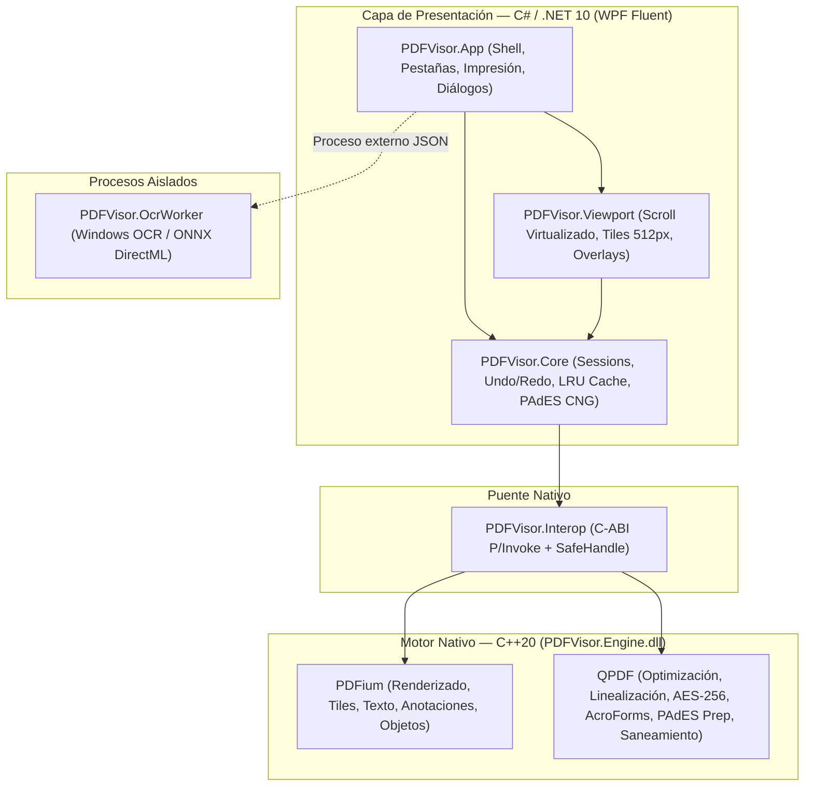

# PDFVisor

**Visor y editor de PDF profesional nativo para Windows (x64)** construido con **C# (.NET 10 / WPF Fluent)** y un **motor nativo en C++20 (`PDFVisor.Engine.dll`)**, utilizando exclusivamente librerías open-source con licencias permisivas (**PDFium**, **QPDF**, **Windows CNG / PKCS#7**, **Windows OCR / ONNX**).

---

## Características principales

### Visualización de alto rendimiento
- **Scroll continuo multipágina virtualizado**: búsqueda binaria `O(log N)` sobre las posiciones acumuladas para abrir documentos de miles de páginas manteniendo solo las páginas visibles en el árbol visual.
- **Renderizado asíncrono por tiles (`512×512 px`) con caché LRU O(1)**: presupuesto estricto de memoria (192 MB) para zoom de hasta 800% sin congelar la interfaz.
- **Interfaz nativa Windows (WPF Fluent Theme)**: soporte de tema claro/oscuro del sistema, **modo lectura oscuro**, pestañas múltiples, miniaturas reales asíncronas y árbol de marcadores.
- **Selección de texto con el ratón + `Ctrl+C`** y búsqueda global entre páginas (`Ctrl+F`) con resaltado vectorial exacto en todas las rotaciones (`0°/90°/180°/270°`).
- **Impresión nativa de Windows (`Ctrl+P`)** a 300 DPI mediante `PrintDialog` y `DocumentPaginator`.

### Edición, organización y anotaciones
- **Organización de páginas con Undo/Redo multinivel**: unir PDFs, mover páginas arriba/abajo, rotar permanentemente (`90°`), extraer páginas a un nuevo archivo y eliminar páginas (con snapshot temporal para poder deshacer borrados).
- **Guardado atómico (`Ctrl+S` / `Ctrl+Shift+S`)**: reemplazo seguro del archivo abierto sin conflictos de bloqueo en Windows.
- **Anotaciones estándar ISO 32000**: resaltado (*Highlight* con *QuadPoints*), rectángulos (*Square*), notas adhesivas (*Text*) y dibujo libre (*Ink*) con vista previa vectorial en tiempo real y Undo/Redo.
- **Edición directa de contenido**: inspector de objetos de página (`Objetos`), edición de texto in-place, inserción de texto Unicode con fuentes TrueType del sistema Windows (`á, é, í, ó, ú, ñ, €`) e inserción de imágenes (`PNG/JPG/BMP`).

### Formularios, seguridad, firmas PAdES y OCR
- **Formularios interactivos (AcroForms)**: lectura, rellenado con generación automática de apariencias y creación de nuevos campos de texto (`/FT /Tx`).
- **Optimización, linealización y cifrado AES-256 (QPDF)**: compresión de *Object Streams*, recompresión Flate, linealización (*Fast Web View*) y cifrado PDF 2.0 (R6 / AES-256) con apertura protegida por contraseña.
- **Firmas digitales PAdES (`ETSI.CAdES.detached`, SHA-256)**:
  - Integración con el almacén personal de certificados de **Windows CNG (`CurrentUser\My`)**, tarjetas inteligentes y tokens USB.
  - Apariencia visual `/AP /N` en el documento, soporte opcional de **sellado de tiempo RFC 3161 (PAdES-B-T)**, verificación criptográfica contra `ByteRange`, validación de cadena `X509Chain` y detección de alteraciones.
- **Redacción / censura permanente real**: elimina físicamente objetos de texto intersectados, enmascara a nivel de píxel las áreas cubiertas en imágenes, limpia la pila Undo y sanea metadatos XMP/`/Info` e historial incremental con QPDF.
- **Worker OCR aislado (`PDFVisor.OcrWorker`)**: reconocimiento por página o por lotes (`OCR Todo`) inyectando una capa de texto invisible buscable (`Tr 3`). Incluye backend offline nativo (`Windows.Media.Ocr`) y arquitectura `IOcrBackend` lista para **ONNX Runtime + DirectML**.

---

## Arquitectura



---

## Requisitos de compilación (Windows x64)

- **Windows 10 / 11 (x64)**
- **Visual Studio 2022** (con la carga de trabajo *Desarrollo para el escritorio con C++* / MSVC)
- **CMake 3.24+**
- **.NET 10 SDK**
- *(Opcional para generar el instalador `.exe`)* **Inno Setup 6**

---

## Inicio rápido

1. **Descargar dependencias nativas (Apache 2.0):**
   ```powershell
   .\scripts\fetch-pdfium.ps1
   .\scripts\fetch-qpdf.ps1
   ```

2. **Compilar el motor nativo C++20 (`PDFVisor.Engine.dll`):**
   ```powershell
   cmake -B build -G "Visual Studio 17 2022" -A x64
   cmake --build build --config Release
   ```

3. **Compilar y ejecutar pruebas end-to-end (xUnit):**
   ```powershell
   dotnet build PDFVisor.slnx -c Release
   dotnet test PDFVisor.slnx -c Release --no-build
   ```

4. **Ejecutar la aplicación de escritorio:**
   ```powershell
   dotnet run --project src/desktop/PDFVisor.App -c Release
   ```

5. **Publicar paquete autocontenido y generar instalador Windows (`.exe`):**
   ```powershell
   .\scripts\publish-win-x64.ps1 -Version 0.8.0
   & "${env:ProgramFiles(x86)}\Inno Setup 6\ISCC.exe" /DMyAppVersion=0.8.0 installer\PDFVisor.iss
   ```

---

## Atajos de teclado

| Atajo | Acción |
| :--- | :--- |
| `Ctrl+O` | Abrir uno o varios archivos PDF |
| `Ctrl+S` / `Ctrl+Shift+S` | Guardar / Guardar como |
| `Ctrl+P` | Imprimir documento (300 DPI) |
| `Ctrl+W` | Cerrar pestaña activa |
| `Ctrl+F` | Buscar texto en el documento |
| `Ctrl+C` | Copiar texto seleccionado |
| `Ctrl+Z` / `Ctrl+Y` | Deshacer / Rehacer |
| `Ctrl++` / `Ctrl+-` / `Ctrl+0` | Acercar / Alejar / Restablecer 100% |
| `Ctrl + Rueda` | Zoom suave |
| `RePág` / `AvPág` | Página anterior / siguiente |

---

## Estructura del repositorio

```text
PDFVisor/
├── .github/workflows/             # CI (build + tests) y Release (instalador .exe + zip)
├── installer/                     # Script Inno Setup 6 (PDFVisor.iss) con asociación .pdf
├── scripts/                       # fetch-pdfium.ps1, fetch-qpdf.ps1, publish-win-x64.ps1
├── src/
│   ├── engine/                    # Motor nativo C++20 (CMake, PDFium + QPDF)
│   │   ├── include/pdfvisor/      # C-ABI pública estable (pdfvisor_capi.h)
│   │   ├── core/                  # Render, tiles, texto, anotaciones, edición y redacción
│   │   └── structure/             # Operaciones QPDF (optimizar, AES-256, AcroForms, PAdES)
│   ├── desktop/
│   │   ├── PDFVisor.Interop/      # Bindings P/Invoke + SafeHandle
│   │   ├── PDFVisor.Core/         # Sesiones, CommandHistory, LruTileCache, PadesSignatureService
│   │   ├── PDFVisor.Viewport/     # Viewport virtualizado multipágina con tiles y overlays
│   │   └── PDFVisor.App/          # Aplicación WPF Fluent + impresión nativa
│   └── workers/
│       └── PDFVisor.OcrWorker/    # Proceso aislado OCR (Windows.Media.Ocr + interfaz ONNX)
└── tests/
    └── desktop-tests/             # Pruebas end-to-end xUnit (motor nativo + .NET)
```

---

## Licencias de componentes

Este proyecto se distribuye bajo licencia **MIT** ([LICENSE](LICENSE)). Todos los componentes integrados utilizan licencias open-source permisivas:

| Componente | Licencia |
| :--- | :--- |
| **PDFium** (precompilados `bblanchon/pdfium-binaries`) | Apache 2.0 / BSD-3-Clause |
| **QPDF** | Apache 2.0 |
| **.NET 10 / WPF / `System.Security.Cryptography.Pkcs`** | MIT |
| **xUnit** | Apache 2.0 |
